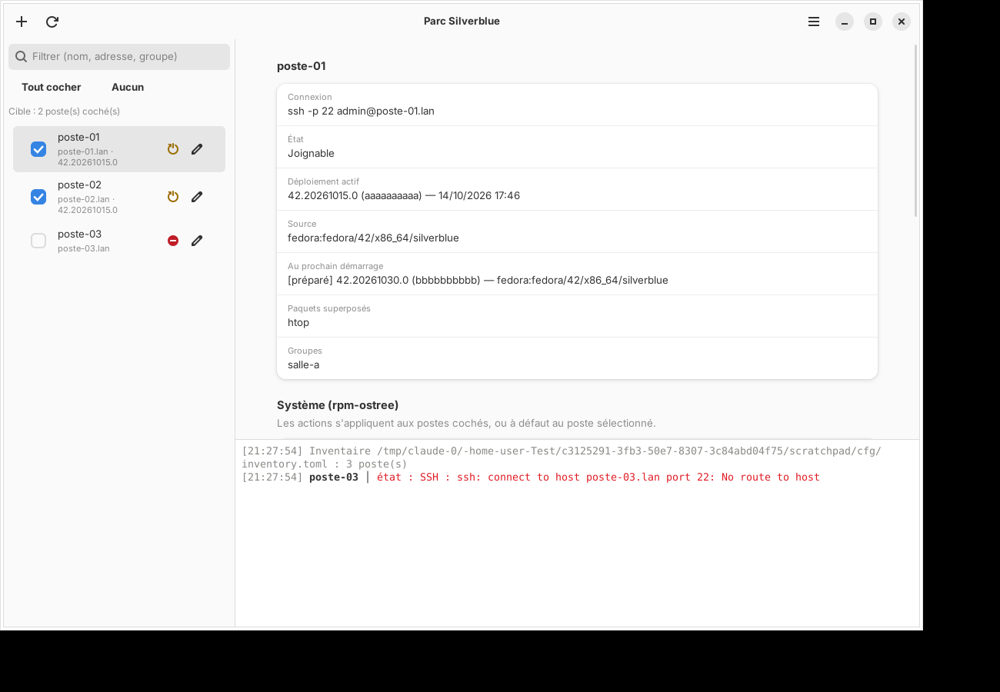

# Parc Silverblue

Outil graphique **GTK 4 / libadwaita** écrit en **Rust** pour administrer un parc
de postes de travail **Fedora Silverblue** (et plus généralement de systèmes
rpm-ostree : Kinoite, Sericea…).



## Fonctionnalités

- **Inventaire** des postes (nom, adresse, utilisateur, port SSH, groupes, notes),
  avec ajout, modification et suppression depuis l'interface, plus une recherche
  par nom, adresse ou groupe.
- **Vue d'état** de chaque poste, obtenue par `rpm-ostree status --json` : version
  et date du déploiement actif, source (ref ostree ou image OCI), paquets
  superposés, déploiement en attente. Un indicateur signale les postes à
  redémarrer ou injoignables.
- **Actions groupées** sur les postes cochés (ou à défaut le poste sélectionné),
  exécutées en parallèle avec un nombre de connexions limité :
  - rpm-ostree : vérifier / appliquer les mises à jour, retour arrière, annuler
    le déploiement en attente, nettoyage, **rebase** (ex. vers une nouvelle
    version de Fedora), installation / retrait de **paquets superposés** ;
  - redémarrage ;
  - **mises à jour automatiques** (`AutomaticUpdatePolicy` +
    `rpm-ostreed-automatic.timer`) ;
  - **Flatpak** (installation système) : lister, tout mettre à jour, installer,
    retirer ;
  - commande personnalisée.
- Confirmation avant les opérations sensibles, **journal** horodaté de toutes
  les commandes et de leurs sorties, rafraîchissement automatique de l'état
  après une modification des déploiements.

## Fonctionnement

L'outil n'installe **aucun agent** sur les postes : il utilise le client
`ssh` du système en mode non interactif (`BatchMode=yes`). Votre
`~/.ssh/config`, l'agent SSH et `known_hosts` sont donc pris en compte. Les
clés d'hôte inconnues sont acceptées au premier contact
(`StrictHostKeyChecking=accept-new`) ; une clé qui change est refusée.

Les commandes privilégiées sont lancées :

- directement si l'utilisateur SSH est `root` ;
- sinon via `sudo -n` (jamais de mot de passe demandé). Un exemple de règle
  sudoers restreinte aux seules commandes nécessaires est fourni dans
  [`data/sudoers.silverblue-fleet`](data/sudoers.silverblue-fleet).

Les noms de paquets, identifiants Flatpak et références de rebase sont
validés avant envoi pour empêcher toute injection dans le shell distant.

## Préparer les postes

Sur chaque poste Silverblue :

```sh
# 1. Activer SSH
sudo systemctl enable --now sshd

# 2. Déposer la clé publique de l'administrateur
ssh-copy-id admin@poste-01.lan

# 3. (si l'utilisateur n'est pas root) autoriser les commandes nécessaires
sudo install -m 0440 sudoers.silverblue-fleet /etc/sudoers.d/silverblue-fleet
sudo visudo -c
```

## Inventaire

Par défaut `~/.config/silverblue-fleet/inventory.toml` ; un autre fichier peut
être passé en argument : `silverblue-fleet /chemin/inventaire.toml`. Voir
[`data/inventory.example.toml`](data/inventory.example.toml) :

```toml
[settings]
max_parallel = 8
connect_timeout = 10
# identity_file = "/home/admin/.ssh/id_ed25519_parc"
flatpak_remote = "flathub"

[[host]]
name = "compta-01"
address = "192.168.10.21"
user = "admin"
port = 22
groups = ["compta", "batiment-b"]
```

Si le fichier est illisible, l'application refuse de le réécrire afin de ne
pas perdre son contenu ; corrigez-le puis utilisez *Menu → Recharger
l'inventaire*.

## Compilation

Dépendances : Rust ≥ 1.75, GTK ≥ 4.12, libadwaita ≥ 1.5.

Sur Fedora Silverblue, dans une toolbox :

```sh
toolbox create && toolbox enter
sudo dnf install -y cargo gtk4-devel libadwaita-devel
cargo build --release
./target/release/silverblue-fleet
```

Sur Debian / Ubuntu : `sudo apt install libgtk-4-dev libadwaita-1-dev`.

Installation locale facultative :

```sh
install -Dm755 target/release/silverblue-fleet ~/.local/bin/silverblue-fleet
install -Dm644 data/io.github.blegalludec.SilverblueFleet.desktop \
  ~/.local/share/applications/io.github.blegalludec.SilverblueFleet.desktop
install -Dm644 data/icons/hicolor/scalable/apps/io.github.blegalludec.SilverblueFleet.svg \
  ~/.local/share/icons/hicolor/scalable/apps/io.github.blegalludec.SilverblueFleet.svg
```

## Flatpak

Le manifeste [`build-aux/flatpak/io.github.blegalludec.SilverblueFleet.yml`](build-aux/flatpak/io.github.blegalludec.SilverblueFleet.yml)
s'appuie sur le runtime GNOME 49 et embarque son propre client OpenSSH. C'est
la méthode recommandée sur Silverblue, sans toolbox ni superposition de paquets :

```sh
flatpak install --user flathub org.gnome.Sdk//49 org.freedesktop.Sdk.Extension.rust-stable//25.08
flatpak install --user flathub org.flatpak.Builder
flatpak run org.flatpak.Builder --user --install --force-clean build-dir \
  build-aux/flatpak/io.github.blegalludec.SilverblueFleet.yml
flatpak run io.github.blegalludec.SilverblueFleet
```

Pour produire un fichier `.flatpak` à distribuer sur d'autres postes :

```sh
flatpak run org.flatpak.Builder --repo=repo --force-clean build-dir \
  build-aux/flatpak/io.github.blegalludec.SilverblueFleet.yml
flatpak build-bundle repo silverblue-fleet.flatpak io.github.blegalludec.SilverblueFleet
flatpak install --user silverblue-fleet.flatpak
```

La CI GitHub construit aussi ce bundle à chaque push (artefact
`silverblue-fleet.flatpak`).

Permissions demandées : réseau, agent SSH de la session (`--socket=ssh-auth`)
et accès à `~/.ssh` (clés, `config`, `known_hosts`). Dans le Flatpak,
l'inventaire par défaut se trouve dans
`~/.var/app/io.github.blegalludec.SilverblueFleet/config/silverblue-fleet/inventory.toml`.
Pour utiliser un inventaire situé ailleurs, autorisez son dossier :
`flatpak override --user --filesystem=~/parc:ro io.github.blegalludec.SilverblueFleet`.

Le dossier `cargo/vendor` utilisé pour la compilation hors ligne est décrit
par `build-aux/flatpak/cargo-sources.json`. Après toute modification de
`Cargo.lock`, régénérez-le (la CI vérifie qu'il est à jour) :

```sh
build-aux/flatpak/generate-cargo-sources.py
```

Raccourcis : `Ctrl+N` ajouter un poste, `Ctrl+R` actualiser l'état.

## Tests

```sh
cargo test
cargo clippy --all-targets -- -D warnings
```

Les tests couvrent l'inventaire, la construction des arguments SSH, l'échappement
shell, la génération et la validation des commandes, l'analyse de la sortie
`rpm-ostree status --json`, et exécutent réellement le script de configuration
des mises à jour automatiques sur une copie de `rpm-ostreed.conf`.

## Organisation du code

| Fichier | Rôle |
| --- | --- |
| `src/inventory.rs` | Modèle et persistance TOML de l'inventaire |
| `src/ssh.rs` | Appel du client OpenSSH, échappement shell |
| `src/actions.rs` | Actions d'administration → commandes distantes |
| `src/ostree.rs` | Analyse de `rpm-ostree status --json` |
| `src/runner.rs` | File d'exécution parallèle hors du thread GTK |
| `src/ui/` | Fenêtre principale et dialogue d'édition des postes |
| `build-aux/flatpak/` | Manifeste Flatpak et sources Cargo hors ligne |
| `data/` | Fichier .desktop, métadonnées AppStream, icônes, exemples |

## Licence

GPL-3.0-or-later
